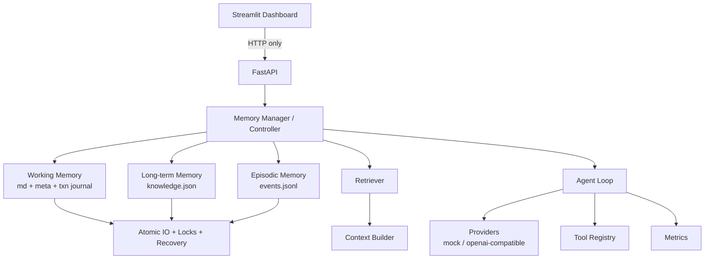

# NanoMemory

[](https://github.com/xixin9988-sys/nanomemory)
[](LICENSE)

**Your AI. Your Memory.** — persistent memory for any AI application.

NanoMemory is a local, file-based **memory engine** for LLM agents: a structured long-term
store with provenance, automatic memory formation, hybrid retrieval, conflict-aware updates,
a reversible forgetting lifecycle and a traceable audit trail. Memory belongs to the user, not
to the model, and it keeps working when no model provider is configured.

> Status: **local single-user engine (v0.2.0)**. Sessions isolate Working Memory *files*, not
> users; multi-user isolation and SQLite/distributed storage are on the roadmap.
> Memory content is always treated as untrusted reference data, never as instructions.

## Measured result (mock mode, same dataset)

| Strategy | Tokens | Token saving | Fact recall |
| --- | --- | --- | --- |
| Full history | 31,964 | 0% | 1.00 |
| Summary memory | 2,158 | 93% | 0.86 |
| NanoMemory (0.1.0, keyword retrieval) | ~10.6k | 67% | **0.39** |
| NanoMemory (0.2.0, hybrid retrieval v2) | 10,650 | 67% | **0.86** |

Same dataset, same mock provider, `runs=1`; the numbers are produced by
`benchmarks/token_benchmark.py` and stored under `benchmarks/results/`. Retrieval quality
improved while token use stayed flat — the point of P0 was recall, not saving tokens.

## Quick start

```bash
pip install -e .            # or: pip install nanomemory
nanomemory init             # create storage, indexes and the default session
nanomemory start            # REST API on http://127.0.0.1:8000
```

```python
from nanomemory import Memory

memory = Memory()  # lite mode: no API key needed
await memory.remember("I prefer Python for tooling.", user_id="user_001")
result = await memory.recall("what language do I prefer?", user_id="user_001")

print(result["intent"])  # "preference"
print(result["items"][0]["reason"])  # "keyword 0.82, semantic 0.61"
```

CLI equivalents: `nanomemory remember "…"`, `nanomemory recall "…"`,
`nanomemory explain <id>`, `nanomemory lifecycle --apply`, `nanomemory doctor`.

The SDK, REST API, MCP server and CLI all use the same rules; nothing in the engine requires a
provider, and `mode=lite` is the default when no key is configured.

## Core features

| Area | What you get |
| --- | --- |
| Memory model | typed memories (`fact / preference / event / procedure / relationship / autobiographical`), provenance, `valid_from`/`valid_until`, `active / superseded / conflict / archived / pending_confirmation` |
| Formation | automatic extraction → validation → dedupe/conflict → commit, with per-type write rules: a model inference is `pending_confirmation`, never presented as a user fact |
| Retrieval | hybrid scoring: BM25 + character-trigram semantic + relation expansion + intent weights + reranking, explainable per signal, with an `insufficient_context` fallback |
| Lifecycle | retention = importance × utility × recency × confidence; archives (never hard-deletes); stable preferences are protected from decay |
| Explainability | `explain(memory_id)` returns provenance, supersede chain and the audit events that created or replaced it |
| SDK / CLI / API / MCP | `from nanomemory import Memory`; `nanomemory init/start/status/remember/recall/explain/lifecycle/doctor`; REST endpoints; MCP tools for DSH |
| Working Memory | `memory.md` (human readable) + `memory.meta.json` sidecar with version and content hash, crash-safe per-transaction journal |
| Long-term Memory | `knowledge.json` with per-record version, confidence/importance rules, conflict flags, 5000-record cap |
| Episodic Memory | append-only `events.jsonl`, corruption quarantine, correction events with audit chain |
| Safety | reject-by-default secret scanning, path/symlink containment, request size limits, admin token for destructive actions |
| Concurrency | cross-process `filelock` resource locks with a fixed acquisition order and timeouts |
| Durability | temp file → flush → fsync → hash verify → atomic replace, plus startup recovery for every crash point |
| Context | untrusted-data separation, XML escaping, 80 % memory budget, total request budget |
| Agent | bounded loop with iterations, timeout, token/tool/cost budgets, allowlisted tools, schema-validated output |
| Providers | deterministic Mock provider (no key needed) and any OpenAI-compatible endpoint |
| API | FastAPI with a uniform error envelope, request ids, rate limiting, OpenAPI docs |
| Dashboard | Streamlit UI that only talks to the API |
| Benchmarks | Full History vs Summary vs NanoMemory, plus retrieval metrics (recall@k, precision@k, provenance coverage) |

## Memory model (2.0)

Every long-term memory carries `memory_id, content, memory_type, source, confidence,
importance, created_at, updated_at, valid_from, valid_until, related_ids, status, provenance`.
Updates never erase evidence: the older record becomes `superseded` with `superseded_by` and a
`valid_until` timestamp, so both the history and the current truth stay queryable.

```json
{
  "id": "mem-…",
  "content": "I use Rust for my services.",
  "memory_type": "preference",
  "status": "active",
  "supersedes": ["mem-…"],
  "provenance": {"source_kind": "user", "source_ref": "conversation", "created_by": "formation"},
  "valid_from": "2026-11-10T12:00:00+00:00"
}
```

`source_kind` distinguishes `user / model / tool / file / composed / import`. A model-derived
memory is stored as `pending_confirmation` unless it is explicitly confirmed.

## Hybrid retrieval

`S(m,q) = w1·S_semantic + w2·S_keyword + w3·S_relation + w4·S_recency + w5·S_importance`

* keyword is BM25 over content, category and tags;
* semantic is a character-trigram cosine, so retrieval works with **no embedding service**;
* relation expands one hop through `related_ids` and supersede links;
* the weights depend on the detected intent (`preference / project_state / decision_history /
  timeline / general`);
* every hit reports its per-signal scores, and when the best content signal is too low the
  result sets `insufficient_context=true` with a reason instead of pretending to answer.

## Lifecycle and explainability

Retention is `importance × utility × recency × confidence`; memories below the floor are
archived after a grace period, and preferences or high-importance memories are never decayed
just because they were not recalled for a while. `explain(memory_id)` answers: where did this
come from, what did it replace, and which audit events touched it.

## Architecture



Details, including the lock matrix and the transaction state machine, are in
[docs/ARCHITECTURE.md](docs/ARCHITECTURE.md).

## Tech stack

Python 3.11+ (developed and verified on 3.12) · FastAPI · Uvicorn · Pydantic v2 ·
pydantic-settings · filelock · openai SDK · Streamlit · pytest · Ruff.

## Project layout

```
NanoMemory/
├── nanomemory/            # single application package (flat layout)
│   ├── core/              # config, storage, locks, transactions, retrieval, agent
│   ├── providers/         # mock + openai-compatible adapters
│   ├── sdk.py             # from nanomemory import Memory
│   ├── cli.py             # nanomemory init/start/remember/recall/explain
│   ├── mcp_server.py      # stdio MCP server (7 tools)
│   ├── api/               # FastAPI app and routes
│   └── dashboard/         # Streamlit app and components
├── benchmarks/            # dataset, runner, CLIs, results
├── scripts/               # init_storage, run_api, run_dashboard, health_probe, cleanup
├── tests/                 # unit + integration tests, fixtures
├── docs/                  # architecture, formats, API, security, benchmarks, 2.0 spec
├── reports/               # real command output, JUnit XML, coverage XML
├── storage/               # runtime memory files (git-ignored)
├── Dockerfile · docker-compose.yml · pyproject.toml
└── README.md · IMPLEMENTATION_PLAN.md · REVIEW_REPORT.md · CHANGELOG.md
```

## Installation

```bash
python -m venv .venv
```

Activate it:

```powershell
# Windows PowerShell
.venv\Scripts\Activate.ps1
```

```bash
# macOS / Linux
source .venv/bin/activate
```

Install the project with development extras:

```bash
pip install -e ".[dev]"
```

Initialise the storage tree and the default session:

```bash
python scripts/init_storage.py
```

> Windows note: if `.venv\Scripts\Activate.ps1` is blocked, run
> `Set-ExecutionPolicy -Scope Process RemoteSigned` for the current shell only, or call
> `.venv\Scripts\python.exe` directly instead of activating.

## Configuration

All settings come from `NANOMEMORY_*` environment variables (environment > `.env` > default).
Copy [`.env.example`](.env.example) to `.env` and edit it. **Never commit `.env`.**

The most important variables:

| Variable | Default | Meaning |
| --- | --- | --- |
| `NANOMEMORY_PROVIDER` | `mock` | `mock` or `openai_compatible` |
| `NANOMEMORY_API_KEY` | – | key for the real provider (never logged) |
| `NANOMEMORY_BASE_URL` | – | OpenAI-compatible base URL |
| `NANOMEMORY_MODEL` | `mock-echo` | model name |
| `NANOMEMORY_STORAGE_ROOT` | `./storage` | memory root (resolved against the project root) |
| `NANOMEMORY_ADMIN_TOKEN` | unset | enables destructive admin endpoints (disabled when unset) |
| `NANOMEMORY_CONTEXT_TOKEN_BUDGET` | `8000` | memory payload budget baseline (memory gets 80 %) |
| `NANOMEMORY_REQUEST_TOKEN_BUDGET` | `8000` | full request budget (product default, not a model limit) |
| `NANOMEMORY_SESSION_MODE` | `single` | `single` or `multi` |
| `NANOMEMORY_LOCK_TIMEOUT_SECONDS` | `5` | lock acquisition timeout |
| `NANOMEMORY_SECRET_SCAN_MODE` | `reject` | `reject` or `redact` |
| `NANOMEMORY_PRICE_TABLE_JSON` | empty | per-model prices; empty means cost is `N/A` |

## Mock mode quick start (no API key)

```bash
python scripts/init_storage.py
python scripts/run_api.py --port 8000
```

In another terminal:

```bash
python scripts/run_dashboard.py --api-url http://127.0.0.1:8000
```

Then open the dashboard (default <http://127.0.0.1:8501>) or exercise the API:

```bash
curl -s http://127.0.0.1:8000/health
curl -s -X POST http://127.0.0.1:8000/api/v1/agent/run \
  -H "Content-Type: application/json" \
  -d '{"task":"summarise the current goal"}'
```

The mock provider is deterministic: it never invents usage numbers and the API reports
`usage_source=mock`.

## Real API mode

```bash
export NANOMEMORY_PROVIDER=openai_compatible
export NANOMEMORY_API_KEY=...            # your own key, never committed
export NANOMEMORY_BASE_URL=https://api.deepseek.com
export NANOMEMORY_MODEL=deepseek-chat
```

Selecting `openai_compatible` without a key fails explicitly with
`provider_not_configured` (HTTP 503) — there is **no silent fallback** to mock, because that
would misrepresent what actually ran.

## Running the API

```bash
uvicorn nanomemory.api.main:app --reload
```

OpenAPI documentation is served at <http://127.0.0.1:8000/docs>. The default bind is local
only; single worker; see [docs/SECURITY.md](docs/SECURITY.md) before exposing it.

## Running the dashboard

```bash
streamlit run nanomemory/dashboard/app.py
```

Environment: `NANOMEMORY_API_URL` (default `http://127.0.0.1:8000`). The dashboard never
opens a storage file; every read and write goes through the API. Destructive actions require
the admin token, which is asked for again on every operation and is never persisted.

## Tests and lint

```bash
pytest -q
ruff check .
ruff format --check .
```

Current: **287 passed, 2 skipped** (see `reports/phase9_pytest.txt`), ruff clean.
Artifacts from the verification run (JUnit XML, coverage XML, command output) are in
[`reports/`](reports/).

## Benchmarks

```bash
python -m benchmarks.token_benchmark --dataset benchmarks/datasets/memory_bench_long.json
python -m benchmarks.task_benchmark --dataset benchmarks/datasets/memory_bench_long.json
python benchmarks/retrieval_benchmark.py
```

Each run writes `report.md` under `benchmarks/results/<run_id>/` plus a `<run_id>_summary.json`
that the dashboard's Benchmark page reads; `retrieval_benchmark.py` also writes
`reports/phase10_retrieval_benchmark.md`.

The default provider is `ContextEchoProvider`: it echoes the context it received, so the
measured fact recall says **whether the context contained the required facts** — it is *not*
a model-capability or real-API measurement. Dataset: `memory_bench_long.json`
(10 questions, ~6,000-character transcripts, SHA-256 in the artifact), 1 run, seed 1234.

| Strategy | Total tokens | Pre-processing | Per query | Fact recall | Token saving vs full history |
| --- | --- | --- | --- | --- | --- |
| Full History | 31,964 | 0 | 3,196 | 1.00 | 0 % |
| Summary Memory | 2,158 | 15,647 | 216 | 0.86 | 93.25 % |
| NanoMemory 0.1.0 (keyword) | 10,532 | 564 | 1,053 | 0.39 | 67.05 % |
| NanoMemory 0.2.0 (hybrid v2) | 10,650 | 564 | 1,065 | **0.86** | 66.68 % |

Reading the table honestly:

- **Per-query tokens** fall sharply for both compressed strategies; the summary strategy only
  wins per query because its one-off summarisation cost (15,647 tokens) is amortised here.
  Over a short session its *total* cost is higher than full history.
- NanoMemory keeps a 67 % token saving **and** now recalls the same 86 % of required facts as
  the summary strategy. The 0.39 → 0.86 change came from hybrid retrieval (BM25 + trigram
  semantic + relation expansion + intent weights), not from loading more memory: token use is
  flat. See `reports/phase10_retrieval_benchmark.md` for the retrieval-only metrics.
- These numbers are **mock-mode** and must not be quoted as real API token or cost results.

A real-API run (`NANOMEMORY_PROVIDER=openai_compatible`) produces files labelled `real-*`
and reports provider-exact token usage when the endpoint returns a usage block. Results are
not copied into this README automatically; re-run the benchmark to refresh them.

## DeepSeek Harness plugin

NanoMemory ships a DSH plugin (`dsh-plugin/`) that mounts the stdio MCP server
(`nanomemory/mcp_server.py`) through DSH's in-box `@deepseek-ai/dsh-mcp-client` bridge. After
installation the model sees seven tools named `mcp__nanomemory__*`.

Install from a checkout:

```bash
dsh plugin --profile desktop add <path-to-repo>/dsh-plugin
```

Then point the profile entry at this checkout (profile `cordis.patch.yml`):

```yaml
- id: mcp-nanomemory
  name: nanomemory-dsh-plugin
  config:
    pythonPath: C:/path/to/NanoMemory/.venv/Scripts/python.exe
    projectRoot: C:/path/to/NanoMemory
    storageRoot: C:/path/to/NanoMemory/storage
```

Restart DSH and the tools appear:

| Tool | Purpose |
| --- | --- |
| `nanomemory_health` | status, provider mode, degraded reasons, budgets |
| `nanomemory_get_working` | Working Memory plus `memory_version` |
| `nanomemory_update_working` | version-checked update (unfinished tasks protected) |
| `nanomemory_add_memory` | store a durable fact (secrets rejected) |
| `nanomemory_search_memory` | keyword search over long-term memory |
| `nanomemory_list_episodes` | append-only audit events with correction status |
| `nanomemory_run_agent` | bounded agent loop with token/tool budgets |

Reproducible install: `python reports/install_dsh_plugin.py --profile <DSH_PROFILE_DIR>`.

The MCP server can also be run directly (`python -m nanomemory.mcp_server`) for any MCP host.
All memory content it returns is untrusted reference data, and the server instructions tell the
model so.

## Roadmap status

The 0.1.0 release solved the safety half (transactions, locks, recovery, quarantine, admin
controls); 0.2.0 focuses on memory quality and cognitive behaviour. The design record is
**[docs/NANOMEMORY_2.0.md](docs/NANOMEMORY_2.0.md)**.

| Phase | Content | Status in 0.2.0 |
| --- | --- | --- |
| P0 Memory quality | hybrid retrieval, reranking, relation expansion, recall benchmark, fallback | **done** (0.86 fact recall; embeddings optional) |
| P1 Cognitive memory | automatic formation, classification, dedupe, conflict/supersede, lifecycle | **done** (deterministic; LLM extraction opt-in) |
| P2 Product experience | SDK, CLI, REST, MCP, backup/restore | **done** except PyPI publication |
| P3 Advanced memory | relation graph, timeline reasoning, user profile, self-evaluation | partial (relations, validity windows) |
| P4 Production | multi-user, permissions, SQLite, multi-instance, observability | not implemented |

## Security

- Secrets are rejected before they reach storage (OpenAI/Anthropic/GitHub/AWS/PEM patterns and
  high-entropy candidates with documented allowlists).
- All memory content is untrusted data: it is delivered in a separate, escaped block and can
  never change tool permissions.
- Paths are resolved and confined to the storage root; symlinks and NTFS junctions are
  rejected in controlled directories.
- Destructive endpoints need `NANOMEMORY_ADMIN_TOKEN` (bearer, constant-time comparison) and
  an explicit confirmation; they are fully disabled when the token is unset.
- Logs pass through a redaction layer that covers messages, structured fields, exception text
  and third-party loggers.

See [docs/SECURITY.md](docs/SECURITY.md) for the threat model and the platform limitations
(directory `fsync` on Windows, MAX_PATH, container UID/GID, single-worker rate limiting).

## Limitations (0.2.0)

- **Single user, local only.** No accounts, no tenant isolation; `user_id` is a filter, not an
  authorization boundary.
- **Single worker.** Cross-process locks are implemented and tested, but rate limiting is
  per-process and multi-worker deployments are not a supported configuration.
- **Semantic search is lexical-semantic.** Character trigrams, not embeddings; an embedding
  provider can be added behind the same interface but is not bundled.
- **One long-term file**, capped at 5000 active records; a SQLite/sharded path is future work.
- **LLM-assisted formation/compression is opt-in**; the deterministic rules are the default so
  no key is required.
- **Docker verification** depends on a working Docker daemon; see the final report for
  whether it was executed in this environment.

## License

MIT — see [LICENSE](LICENSE).
