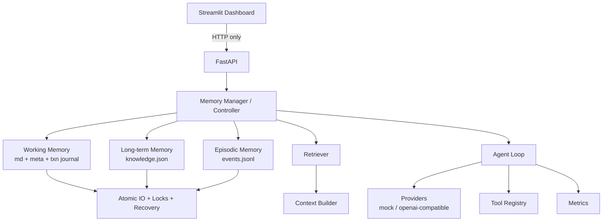

# NanoMemory

**A lightweight, persistent and token-efficient memory engine for AI agents.**

NanoMemory is a local, file-based memory layer for LLM agents. Instead of appending the whole
conversation to every request, it keeps a small structured Working Memory, a long-term
knowledge store and an append-only event log — and loads only what the current task needs.

> Status: **Local single-user MVP** (v1). Sessions isolate Working Memory *files*, not users.
> Memory content is always treated as untrusted reference data, never as instructions.

---

## Problem

Conversational agents usually resend their entire history:

- context grows without bound and every turn costs more tokens,
- repeated information crowds out the current task,
- state does not survive a session in a reviewable form,
- memory updates, conflicts and deletions have no rules,
- nobody measures whether a "memory strategy" actually helps.

NanoMemory replaces that with readable, versioned, lock-protected files and a measured
context assembly step.

## Core features

| Area | What you get |
| --- | --- |
| Working Memory | `memory.md` (human readable) + `memory.meta.json` sidecar with version and content hash, crash-safe per-transaction journal |
| Long-term Memory | `knowledge.json` with per-record version, provenance, confidence/importance rules, conflict flags, 5000-record cap |
| Episodic Memory | append-only `events.jsonl`, corruption quarantine, correction events with audit chain |
| Safety | reject-by-default secret scanning, path/symlink containment, request size limits, admin token for destructive actions |
| Concurrency | cross-process `filelock` resource locks with a fixed acquisition order and timeouts |
| Durability | temp file → flush → fsync → hash verify → atomic replace, plus startup recovery for every crash point |
| Retrieval | explainable keyword/tag/importance/recency scoring under a hard token budget |
| Context | untrusted-data separation, XML escaping, 80 % memory budget, total request budget |
| Agent | bounded loop with iterations, timeout, token/tool/cost budgets, allowlisted tools, schema-validated output |
| Providers | deterministic Mock provider (no key needed) and any OpenAI-compatible endpoint |
| API | FastAPI with a uniform error envelope, request ids, rate limiting, OpenAPI docs |
| Dashboard | Streamlit UI that only talks to the API |
| Benchmarks | Full History vs Summary vs NanoMemory with reproducible artifacts |

## Architecture



Details, including the lock matrix and the transaction state machine, are in
[docs/ARCHITECTURE.md](docs/ARCHITECTURE.md).

## Tech stack

Python 3.11+ (developed and verified on 3.12) · FastAPI · Uvicorn · Pydantic v2 ·
pydantic-settings · filelock · openai SDK · Streamlit · pytest · Ruff.

## Project layout

```
NanoMemory/
├── nanomemory/            # single application package (flat layout)
│   ├── core/              # config, storage, locks, transactions, retrieval, agent
│   ├── providers/         # mock + openai-compatible adapters
│   ├── api/               # FastAPI app and routes
│   └── dashboard/         # Streamlit app and components
├── benchmarks/            # dataset, runner, CLIs, results
├── scripts/               # init_storage, run_api, run_dashboard, health_probe, cleanup
├── tests/                 # unit + integration tests, fixtures
├── docs/                  # architecture, formats, API, security, benchmarks
├── reports/               # real command output, JUnit XML, coverage XML
├── storage/               # runtime memory files (git-ignored)
├── Dockerfile · docker-compose.yml · pyproject.toml
└── README.md · IMPLEMENTATION_PLAN.md · REVIEW_REPORT.md · CHANGELOG.md
```

## Installation

```bash
python -m venv .venv
```

Activate it:

```powershell
# Windows PowerShell
.venv\Scripts\Activate.ps1
```

```bash
# macOS / Linux
source .venv/bin/activate
```

Install the project with development extras:

```bash
pip install -e ".[dev]"
```

Initialise the storage tree and the default session:

```bash
python scripts/init_storage.py
```

> Windows note: if `.venv\Scripts\Activate.ps1` is blocked, run
> `Set-ExecutionPolicy -Scope Process RemoteSigned` for the current shell only, or call
> `.venv\Scripts\python.exe` directly instead of activating.

## Configuration

All settings come from `NANOMEMORY_*` environment variables (environment > `.env` > default).
Copy [`.env.example`](.env.example) to `.env` and edit it. **Never commit `.env`.**

The most important variables:

| Variable | Default | Meaning |
| --- | --- | --- |
| `NANOMEMORY_PROVIDER` | `mock` | `mock` or `openai_compatible` |
| `NANOMEMORY_API_KEY` | – | key for the real provider (never logged) |
| `NANOMEMORY_BASE_URL` | – | OpenAI-compatible base URL |
| `NANOMEMORY_MODEL` | `mock-echo` | model name |
| `NANOMEMORY_STORAGE_ROOT` | `./storage` | memory root (resolved against the project root) |
| `NANOMEMORY_ADMIN_TOKEN` | unset | enables destructive admin endpoints (disabled when unset) |
| `NANOMEMORY_CONTEXT_TOKEN_BUDGET` | `8000` | memory payload budget baseline (memory gets 80 %) |
| `NANOMEMORY_REQUEST_TOKEN_BUDGET` | `8000` | full request budget (product default, not a model limit) |
| `NANOMEMORY_SESSION_MODE` | `single` | `single` or `multi` |
| `NANOMEMORY_LOCK_TIMEOUT_SECONDS` | `5` | lock acquisition timeout |
| `NANOMEMORY_SECRET_SCAN_MODE` | `reject` | `reject` or `redact` |
| `NANOMEMORY_PRICE_TABLE_JSON` | empty | per-model prices; empty means cost is `N/A` |

## Mock mode quick start (no API key)

```bash
python scripts/init_storage.py
python scripts/run_api.py --port 8000
```

In another terminal:

```bash
python scripts/run_dashboard.py --api-url http://127.0.0.1:8000
```

Then open the dashboard (default <http://127.0.0.1:8501>) or exercise the API:

```bash
curl -s http://127.0.0.1:8000/health
curl -s -X POST http://127.0.0.1:8000/api/v1/agent/run \
  -H "Content-Type: application/json" \
  -d '{"task":"summarise the current goal"}'
```

The mock provider is deterministic: it never invents usage numbers and the API reports
`usage_source=mock`.

## Real API mode

```bash
export NANOMEMORY_PROVIDER=openai_compatible
export NANOMEMORY_API_KEY=...            # your own key, never committed
export NANOMEMORY_BASE_URL=https://api.deepseek.com
export NANOMEMORY_MODEL=deepseek-chat
```

Selecting `openai_compatible` without a key fails explicitly with
`provider_not_configured` (HTTP 503) — there is **no silent fallback** to mock, because that
would misrepresent what actually ran.

## Running the API

```bash
uvicorn nanomemory.api.main:app --reload
```

OpenAPI documentation is served at <http://127.0.0.1:8000/docs>. The default bind is local
only; single worker; see [docs/SECURITY.md](docs/SECURITY.md) before exposing it.

## Running the dashboard

```bash
streamlit run nanomemory/dashboard/app.py
```

Environment: `NANOMEMORY_API_URL` (default `http://127.0.0.1:8000`). The dashboard never
opens a storage file; every read and write goes through the API. Destructive actions require
the admin token, which is asked for again on every operation and is never persisted.

## Tests and lint

```bash
pytest -q
ruff check .
ruff format --check .
```

Artifacts from the verification run (JUnit XML, coverage XML, command output) are in
[`reports/`](reports/).

## Benchmarks

```bash
python -m benchmarks.token_benchmark --dataset benchmarks/datasets/memory_bench_long.json
python -m benchmarks.task_benchmark --dataset benchmarks/datasets/memory_bench_long.json
```

Each run writes `cases.json`, `raw_results.jsonl`, `summary.json`, `summary.csv` and
`report.md` under `benchmarks/results/<run_id>/`, plus a `<run_id>_summary.json` that the
dashboard's Benchmark page reads.

### Measured results (mock mode, context-coverage proxy)

The default provider is `ContextEchoProvider`: it echoes the context it received, so the
measured fact recall says **whether the context contained the required facts** — it is *not*
a model-capability or real-API measurement. Dataset: `memory_bench_long.json`
(10 questions, ~6,000-character transcripts, SHA-256 in the artifact), 1 run, seed 1234.

| Strategy | Total tokens | Pre-processing | Per query | Fact recall | Token saving vs full history |
| --- | --- | --- | --- | --- | --- |
| Full History | 31,964 | 0 | 3,196 | 1.00 | 0 % |
| Summary Memory | 2,158 | 15,647 | 216 | 0.86 | 93.25 % |
| NanoMemory | 10,532 | 564 | 1,053 | 0.39 | 67.05 % |

Reading the table honestly:

- **Per-query tokens** fall sharply for both compressed strategies; the summary strategy only
  wins per query because its one-off summarisation cost (15,647 tokens) is amortised here.
  Over a short session its *total* cost is higher than full history.
- NanoMemory saves 67 % of per-query input tokens on these transcripts but **recalls only
  39 %** of the required facts with the current keyword retriever, versus 100 % for full
  history. That quality loss is a real limitation, not a rounding error: token savings
  without fact recall are not an improvement.
- These numbers are **mock-mode** and must not be quoted as real API token or cost results.

A real-API run (`NANOMEMORY_PROVIDER=openai_compatible`) produces files labelled `real-*`
and reports provider-exact token usage when the endpoint returns a usage block. Results are
not copied into this README automatically; re-run the benchmark to refresh them.

## Security

- Secrets are rejected before they reach storage (OpenAI/Anthropic/GitHub/AWS/PEM patterns and
  high-entropy candidates with documented allowlists).
- All memory content is untrusted data: it is delivered in a separate, escaped block and can
  never change tool permissions.
- Paths are resolved and confined to the storage root; symlinks and NTFS junctions are
  rejected in controlled directories.
- Destructive endpoints need `NANOMEMORY_ADMIN_TOKEN` (bearer, constant-time comparison) and
  an explicit confirmation; they are fully disabled when the token is unset.
- Logs pass through a redaction layer that covers messages, structured fields, exception text
  and third-party loggers.

See [docs/SECURITY.md](docs/SECURITY.md) for the threat model and the platform limitations
(directory `fsync` on Windows, MAX_PATH, container UID/GID, single-worker rate limiting).

## Limitations (v1)

- **Single user, local only.** No accounts, no tenant isolation, no multi-user claims.
- **Single worker.** Cross-process locks are implemented and tested, but rate limiting is
  per-process and multi-worker deployments are not a supported configuration.
- **Keyword retrieval.** No embeddings; recall on large stores is limited (see benchmark).
- **One long-term file**, capped at 5000 active records; a SQLite/sharded path is future work.
- **LLM-assisted compression is off by default** and must be enabled explicitly.
- **Docker verification** depends on a working Docker daemon; see the final report for
  whether it was executed in this environment.

## Roadmap

1. Embedding/hybrid retrieval with the same explainability and budget contract.
2. SQLite-backed long-term store behind the existing interface.
3. Shared rate-limit backend and multi-worker support with cross-process validation.
4. Optional human-labelled task-success set for the benchmark.
5. Export/import tooling and dashboard diffing of memory versions.

## License

MIT — see [LICENSE](LICENSE).
