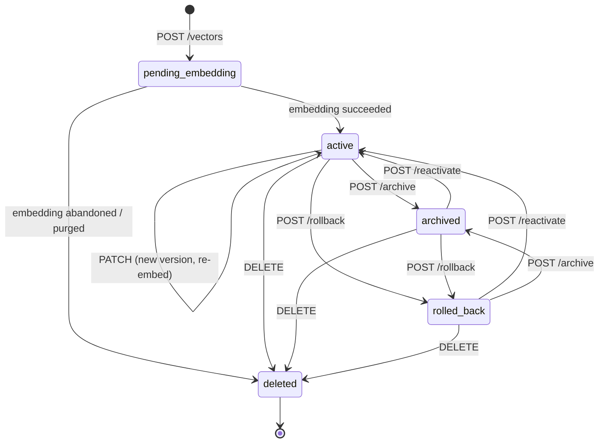

# Memory lifecycle state machine (v2)

The v1 long-term store used a status enum without a transition guard: any code path could write
any status. v2 makes the state machine explicit and enforced in one place
(`VectorMemoryService._transition_record`), so an invalid transition is a 409 rather than a
silently inconsistent row.

## States

| State | Retrievable | Meaning |
| --- | --- | --- |
| `pending_embedding` | no | accepted by the API, embedding not yet stored (or failed) |
| `active` | **yes** | current truth, embedded, in the retrieval candidate set |
| `archived` | no | retired from retrieval but kept for audit and reactivation |
| `deleted` | no | soft-deleted; terminal for the public API |
| `rolled_back` | no | content restored from a historical version; must be reviewed and reactivated |

## Diagram

## Transition table

| From | To | Trigger | Guard | Side effects | Failure handling |
| --- | --- | --- | --- | --- | --- |
| — | `pending_embedding` | `POST /memory/vectors` | schema validation, ACL subset check, idempotency lookup | row inserted with `version=1`, trace `write` | embedding error keeps the row pending and returns 503 with `memory_id` |
| `pending_embedding` | `active` | embedding success | dimension equals configured dimension | vector + model + hash stored, `state_reason=null` | none (already committed) |
| `pending_embedding` | `deleted` | abandonment | explicit delete | `deleted_at` set | — |
| `active` | `active` | `PATCH` | `expected_version` matches; ACL subset | new `version` row, previous version retained, re-embed only when content changed | embedding failure leaves the previous version fully intact (no write) |
| `active` | `archived` | `POST /{id}/archive` | `expected_version` (optional) | state change + new version row, vector retained | — |
| `archived` | `active` | `POST /{id}/reactivate` | embedding present | state change | 409 when no embedding exists (use retry-embedding) |
| `active`/`archived` | `rolled_back` | `POST /{id}/rollback` | target version exists | content/metadata/ACL/vector restored from history as a **new** version; `rolled_back_from` set | target version without a vector is re-embedded; failure aborts without writing |
| `rolled_back` | `active` | `POST /{id}/reactivate` | — | state change | 409 if no embedding |
| any non-deleted | `deleted` | `DELETE` | optional version check | `deleted_at` set, row kept | — |
| `deleted` | anything | — | — | rejected | 409 `invalid_state_transition` |

## Embedding retry semantics

- The provider call is retried `NANOMEMORY_EMBEDDING_MAX_RETRIES` times when the error is
  retryable (timeout, connection, 429, 5xx). Authentication and malformed-response errors are not
  retried.
- Exhausted retries never discard user data: the row stays `pending_embedding` with a
  `state_reason` like `embedding_failed: TimeoutException`, and
  `POST /memory/vectors/{id}/retry-embedding` resumes it.
- A pending row never appears in retrieval: the candidate query filters on `state='active'`
  before any similarity computation.

## Rollback semantics

Rollback is intentionally **not** "restore and serve". The restored content becomes
`rolled_back` so a human can review it; only `reactivate` returns it to the candidate set.
This prevents an accidental rollback from silently re-introducing a retracted fact into answers.

Version history is append-only: rolling back to v1 creates v3 (not "v2 again"), so the audit
chain `v1 → v2 → v1` remains visible in `GET /memory/vectors/{id}/versions`.

## Invariants enforced by the store

1. `content_sha256` always matches `content` (validated on read and write).
2. `deleted_at` is non-null **iff** the state is `deleted`.
3. A `version` number is unique per memory id and never reused.
4. Every write emits a trace row; a trace failure is logged and never fails the user request.
5. A search never scans rows outside the pre-filter SQL (tenant, user/ACL, state, expiry).
